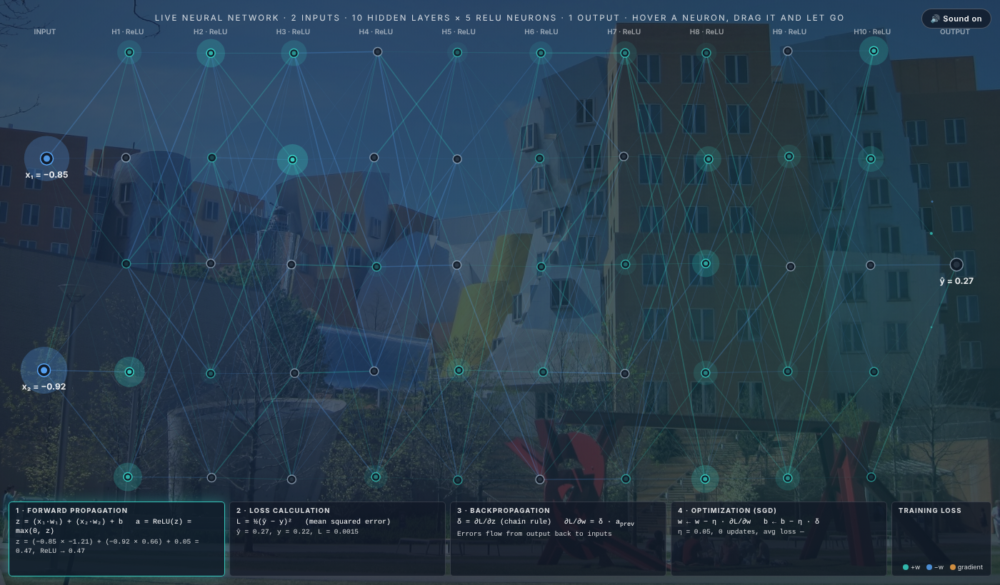

# Live neural network training animation

**Designed and created by Gregory Gasowski** · [gregorygasowski.github.io](https://gregorygasowski.github.io)

### ▶ [Live demo: wavemx.github.io/live-neural-network/neural-network.html](https://wavemx.github.io/live-neural-network/neural-network.html)

A neural network that trains live in the browser while you watch. Every forward pass, loss calculation, backpropagation step and weight update is real math, animated as it happens. Hover any neuron to see its actual calculation with the current numbers.



## Highlights

- **Network:** 2 inputs (x₁, x₂), 10 hidden layers of 5 ReLU neurons, and 1 output (ŷ)
- **Real training:** mini-batch SGD with He initialization and gradient clipping, learning a hidden function of x₁ and x₂
- **Four animated steps:** forward propagation, loss calculation, backpropagation, optimization
- **Hover a neuron:** see z = (x₁·w₁) + (x₂·w₂) + b and a = ReLU(z) = max(0, z) with live values, plus its error δ and gradient after backpropagation
- **Training loss chart:** watch the loss fall as the network learns
- **Drag a neuron:** pull it anywhere and it springs back (visual only; the math is untouched)
- **Analog synth sounds:** generated live with the Web Audio API, with a mute button
- **No dependencies:** plain HTML and JavaScript, no build step, nothing loaded from the internet

## Run it

Try the **[live demo](https://wavemx.github.io/live-neural-network/neural-network.html)**, or download or clone the repository and open `neural-network.html` in any modern browser.

```
git clone https://github.com/wavemx/live-neural-network.git
```

## Files

| File | Purpose |
|---|---|
| `neural-network.html` | The page: background, header, step panel, loss chart, hover box, sound button |
| `neural-network.js` | The model, training, animation, interaction and sound |
| `background.jpg` | Background photo |
| `neural-network-explained.md` | Full explanation of every part, the math behind it, and the reasoning for each design choice |
| `index.html` | Opens the demo when visiting the site root |
| `LICENSE` | MIT License |

## How it works

See **[neural-network-explained.md](neural-network-explained.md)** for the configuration, model, forward and backward math, mini-batch training, gradient clipping, the loss chart, automatic restart, interaction and sound design.

## Customize

All settings are in the `CONFIG` object at the top of `neural-network.js`: number of layers and neurons, learning rate, animation speed, and the function the network learns.

## License

[MIT](LICENSE) © 2026 Gregory Gasowski. You are free to use, modify and share this project, as long as the copyright notice and license are kept, which credits the original author.

---

Designed and created by **Gregory Gasowski**
